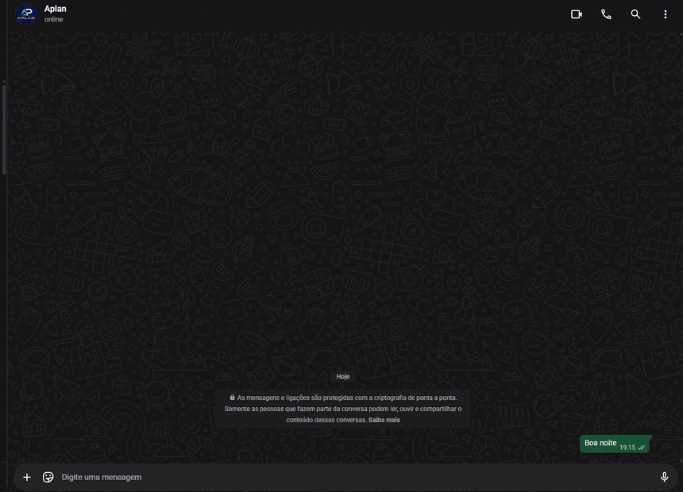
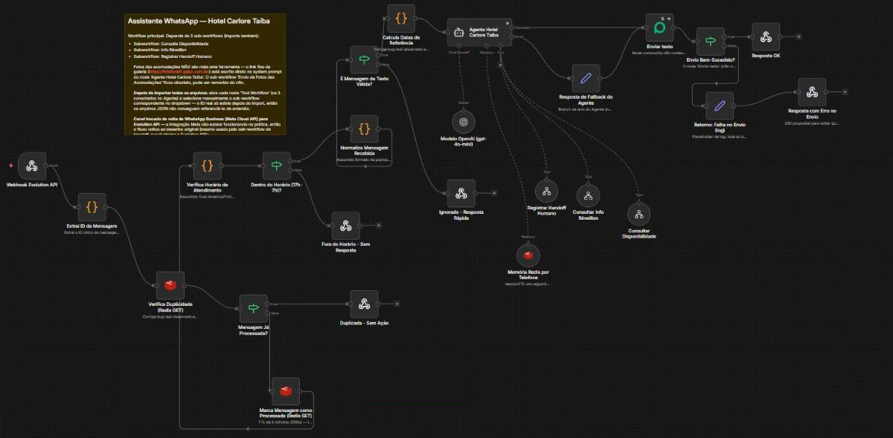
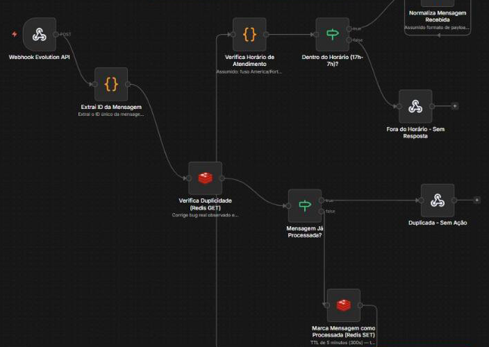
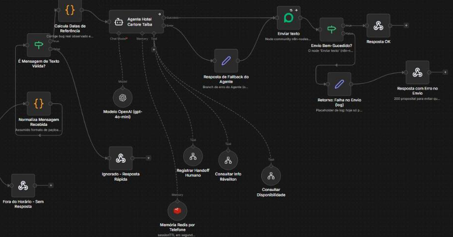
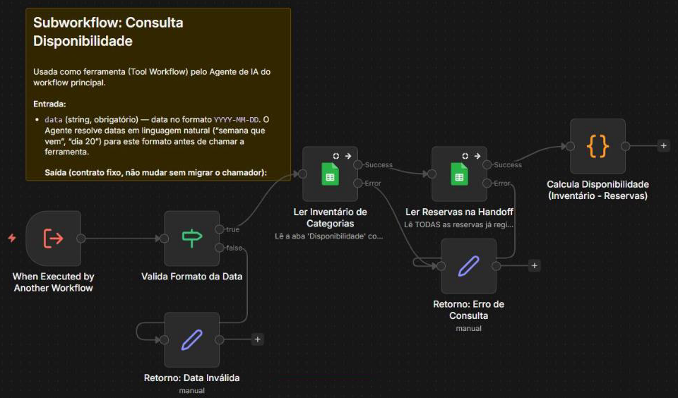
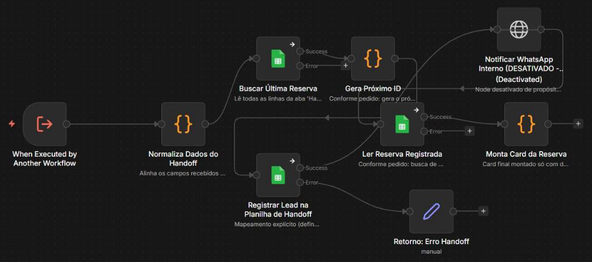
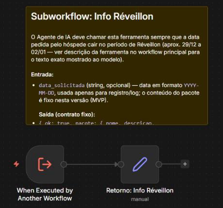

# Atendimento de Hotel no WhatsApp - n8n

Agente de atendimento para reservas de hotel, construído no **n8n** e integrado ao **WhatsApp** pela Evolution API. Ele responde os hóspedes fora do horário comercial, envia a galeria de fotos das acomodações, consulta a disponibilidade de quartos em uma planilha do Google e registra a reserva para a equipe confirmar depois. Está em produção.

## Demonstração

O hóspede pede fotos e disponibilidade para duas noites, o agente consulta a planilha, mostra as categorias com preço e registra a reserva.

> Projeto desenvolvido para um cliente e em uso no atendimento do hotel. Por isso o fluxo é apresentado apenas com prints, sem o arquivo de exportação do n8n e sem credenciais.

## Workflow principal

**Entrada da mensagem:** webhook, controle de duplicidade e horário de atendimento.

**Agente de IA:** modelo, memória, ferramentas, envio da resposta e tratamento de falhas.

1. **Recebe a mensagem** do WhatsApp por webhook (Evolution API) e extrai o ID da mensagem.
2. **Evita respostas duplicadas**: verifica no Redis se a mensagem já foi processada e, se não, marca o ID com validade de 5 minutos.
3. **Verifica o horário de atendimento**: o agente atende das 17h às 7h. Fora desse período a equipe do hotel responde.
4. **Normaliza a mensagem** e confere se é um texto válido.
5. **Calcula datas de referência** para o agente entender pedidos como "semana que vem" ou "dia 20".
6. **Responde com o agente de IA** (OpenAI), com memória da conversa no Redis por telefone e três ferramentas:
   - Consultar Disponibilidade;
   - Consultar Info Réveillon;
   - Registrar Handoff Humano (reserva).
7. **Envia a resposta** pelo WhatsApp. Se o agente ou o envio falharem, o fluxo segue por um caminho de fallback e registra a falha.

## Subworkflows

### Consulta Disponibilidade

- Valida a data recebida (`YYYY-MM-DD`).
- Lê o inventário de quartos por categoria na aba `Disponibilidade`.
- Lê as reservas já registradas na aba de handoff.
- Calcula a disponibilidade de cada categoria (inventário menos reservas) e devolve ao agente com o preço da diária.
- Data inválida ou erro de leitura voltam como retorno tratado, sem quebrar a conversa.

### Registrar Reserva (handoff humano)

- Normaliza os dados coletados pelo agente: nome, categoria, check-in, check-out e detalhes.
- Busca a última reserva e gera o próximo ID (`RES001`, `RES002`...).
- Registra a reserva na planilha para a equipe confirmar no horário comercial.
- Lê a reserva gravada e monta o card de confirmação enviado ao hóspede.

### Info Réveillon

Chamado quando a data pedida cai no período de Réveillon. Devolve as informações do pacote especial.

## Planilha

- **Aba `Disponibilidade`:** categorias de quarto (Standard, Suíte Casal, Família), quantidade de quartos e valor da diária.
- **Aba de handoff (reservas):** ID, nome, categoria, check-in, check-out e detalhes da reserva.

## Tecnologias

- n8n
- Evolution API (WhatsApp)
- OpenAI (gpt-4o-mini)
- Google Sheets
- Redis (memória da conversa e controle de duplicidade)

## Autor

Paulo Victor Martins Carneiro
